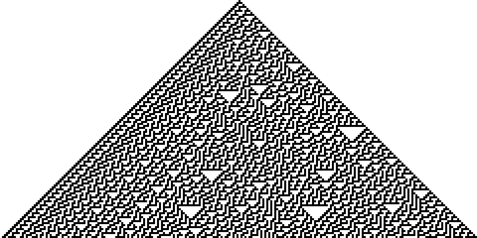
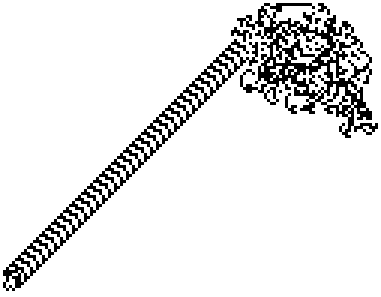

# automata

Elementary cellular automata and Langton's ant. Output goes to the terminal (half-block characters, so two rows per line) or to a `.png` / `.pgm` file. The PNG writer uses only `zlib` and `struct`.

```sh
python3 automata.py rule 90 --width 63 --steps 32      # Sierpinski triangle in the terminal
python3 automata.py rule 30 --width 240 --steps 120 --scale 4 --out rule30.png
python3 automata.py ant --steps 14000 --scale 3 --out ant.png
python3 -m unittest -q
```

| Rule 30 | Langton's ant, 14,000 steps |
|---|---|
|  |  |

The ant spends roughly the first 10,000 steps in apparent chaos and then locks into a 104-step cycle that carries it off diagonally forever, the "highway". No one has proved that every starting pattern ends up there. The tests check the highway: after 11,000 steps, 104 more steps move the ant exactly two cells diagonally, and the next 104 move it the same way again.

Rule 90 is checked against Pascal's triangle mod 2: row *n* has `2^popcount(n)` live cells.
